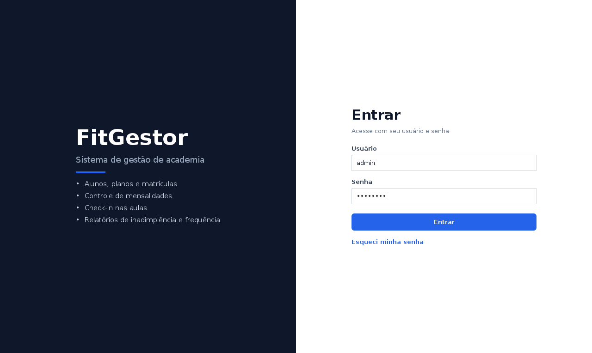
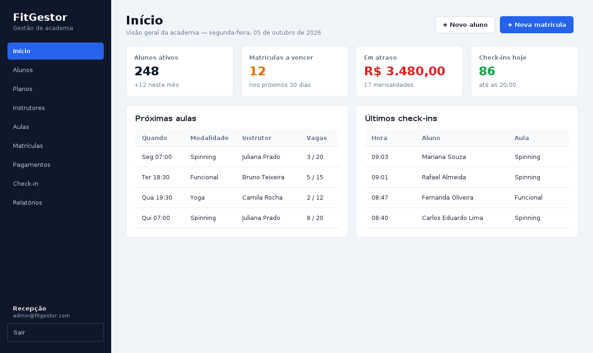
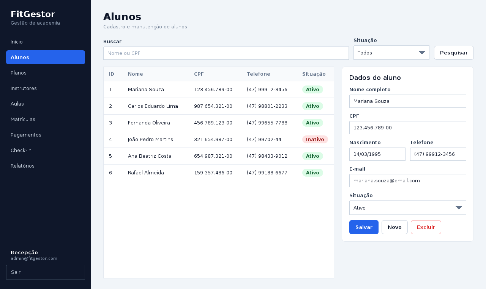
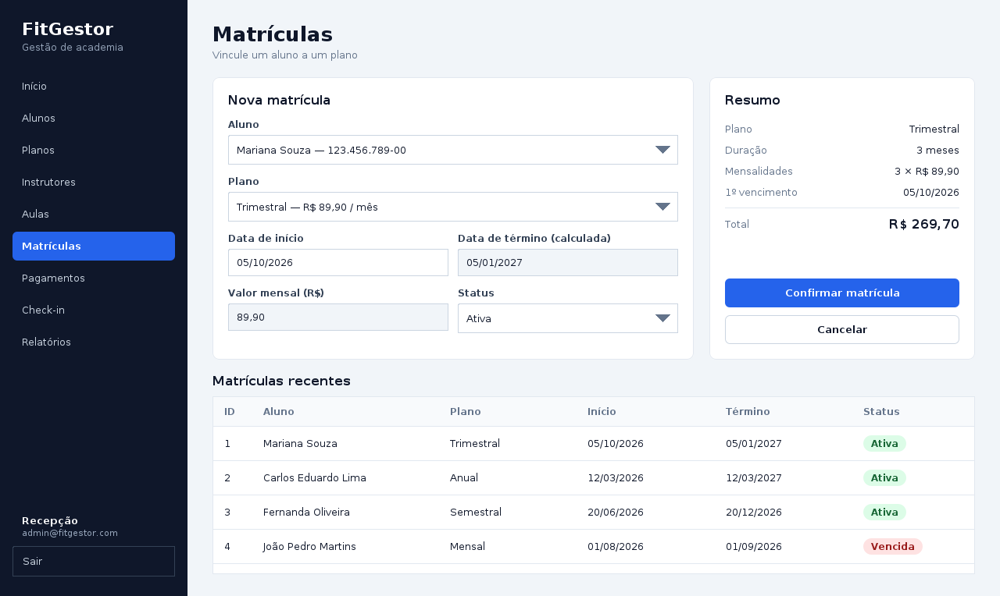
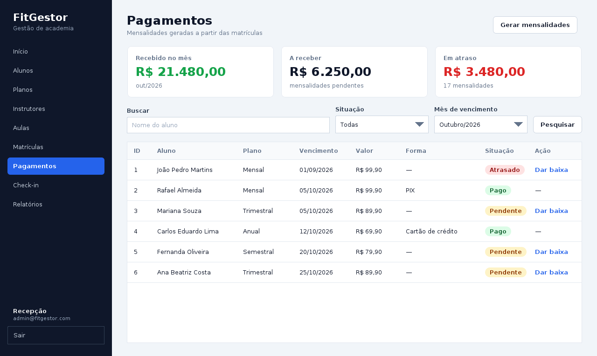
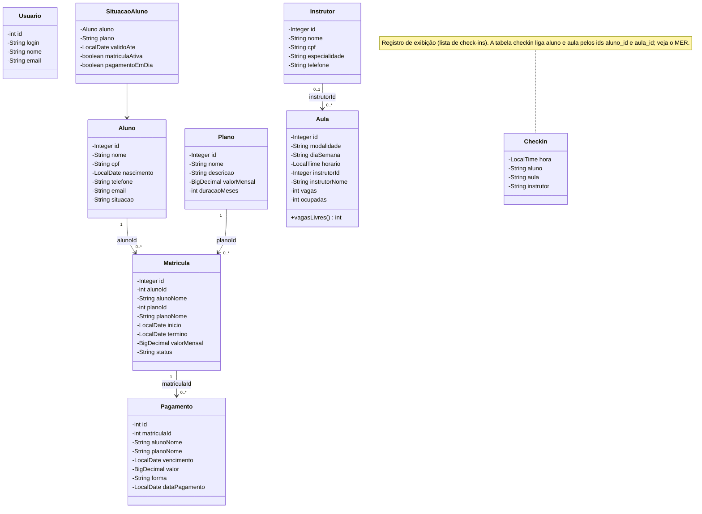
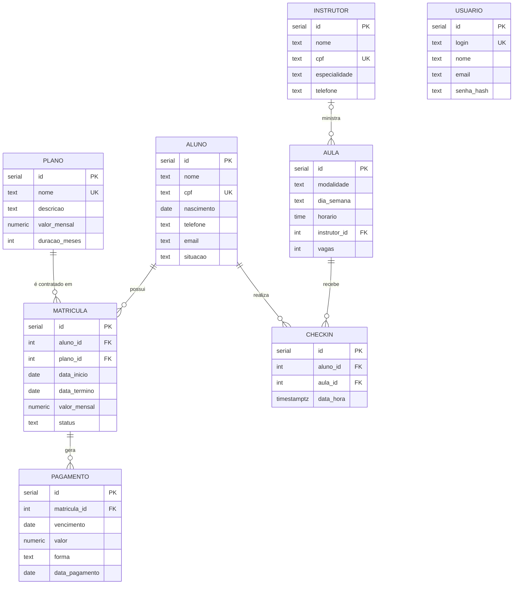

# FitGestor — Sistema de Gestão de Academia

Sistema desktop em **Java Swing**, com banco de dados **PostgreSQL** e padrão de projeto **MVC**.

**Disciplina:** _PROGRAMAÇÃO ORIENTADA A OBJETOS II_ · **Curso:** Engenharia de Software — Univille

**Integrantes:** _Matthäus de Paula, João Gabriel Nasario, Rafaela Gusczak, Nicolas Rodrigues da Silveira_

## Tema

O FitGestor controla o dia a dia de uma academia: cadastro de alunos, planos, instrutores e aulas; matrícula do aluno em um plano; geração e baixa das mensalidades; check-in nas aulas; e relatórios gerenciais (inadimplência, frequência e matrículas a vencer).

## Protótipos de tela

Protótipos navegáveis feitos no Figma (10 telas): **[abrir no Figma](https://www.figma.com/design/whSCkb0V4EHQLKJOCnhzbV)**

Telas: Login · Início · Alunos · Planos · Instrutores · Aulas · Matrículas · Pagamentos · Check-in · Relatórios.

### Telas implementadas

| Login | Início |
|---|---|
|  |  |

| Alunos | Matrículas | Pagamentos |
|---|---|---|
|  |  |  |

## Diagrama de classes

Reflete as classes do pacote `model`, como estão no código (todas são `record`). A ligação entre as entidades é feita pelo **id** (`alunoId`, `planoId`, `matriculaId`, `instrutorId`), o mesmo desenho do banco. Alguns campos extras (`alunoNome`, `planoNome`, `instrutorNome`, `ocupadas`) vêm de consultas com `join` e servem só para exibir os dados nas tabelas.



**Valores dos campos de texto:**
- `Aluno.situacao`: Ativo, Inativo
- `Matricula.status`: Ativa, Trancada, Cancelada
- `Pagamento.forma`: PIX, Dinheiro, Cartão de crédito, Cartão de débito, Boleto
- `Aula.diaSemana`: Segunda a Domingo

**Observações:**
- `Checkin` e `SituacaoAluno` são classes de consulta: `Checkin` lista os check-ins (hora, aluno, aula, instrutor) e `SituacaoAluno` diz se o aluno pode entrar (matrícula ativa e pagamento em dia). A gravação do check-in usa direto os ids de aluno e de aula.
- Uma mensalidade está **paga** quando `dataPagamento` é preenchida (e exige uma `forma`); está **atrasada** quando o vencimento já passou sem pagamento.
- `Usuario` guarda o login do sistema e não se relaciona com as demais entidades.

## Diagrama MER

Modelo físico do banco (`db/schema.sql`), com as 7 tabelas do negócio e a tabela `usuario`, usada no login.



### Do diagrama de classes para o MER

| Diagrama de classes | MER |
|---|---|
| Classes em Java (`Aluno`) | Tabelas (`aluno`) |
| `camelCase` (`valorMensal`) | `snake_case` (`valor_mensal`) |
| `String`, `BigDecimal`, `LocalDate` | `text`, `numeric`, `date` |
| Referência por id (`alunoId`) | Chave estrangeira (`aluno_id`) |

## Arquitetura (MVC)

```
src/
├── Main.java            janela principal (alterna entre login e sistema)
├── model/               entidades (records): Aluno, Plano, Matricula, Pagamento...
├── view/                telas Swing: uma classe por tela + componentes (Tema, Mascara)
├── controller/          regras de negócio: Auth, Matricula, Pagamento, Checkin
├── dao/                 acesso ao banco via JDBC: um DAO por tabela + RelatorioDao
├── db/                  conexão com o PostgreSQL (Banco)
└── util/                datas, formatação e tratamento de erros
db/
├── schema.sql           criação das tabelas
└── seed.sql             dados iniciais
lib/                     driver JDBC do PostgreSQL
docs/                    imagens do README
```

**Fluxo:** a `view` captura a ação do usuário → chama o `controller` → que aplica as regras e usa os `dao` → que leem e gravam no banco e devolvem objetos do `model`. As consultas rodam em uma thread separada (`Banco.async`), para a tela não travar enquanto espera o banco.

**Regras de negócio implementadas:**
- A data de término da matrícula é calculada pela duração do plano.
- As mensalidades são geradas a partir das matrículas, e a baixa registra data e forma de pagamento.
- O check-in consulta se o aluno tem matrícula ativa e pagamento em dia.
- Relatórios de inadimplentes, frequência por aluno e matrículas a vencer.

## Tecnologias

- Java 17 ou superior (Swing)
- PostgreSQL (hospedado no Supabase)
- JDBC (driver `postgresql-42.7.7`, na pasta `lib/`)
- Figma (protótipos) e Mermaid (diagramas)

## Como executar

**1. Banco de dados.** Crie um banco PostgreSQL (ou um projeto no Supabase) e execute, nesta ordem, no editor SQL ou com `psql`:

```bash
db/schema.sql   # cria as tabelas
db/seed.sql     # insere planos, instrutores, alunos e o usuário inicial
```

**2. Configuração.** Copie `db.properties.example` para `db.properties` (na raiz do projeto) e preencha com os dados do seu banco. Esse arquivo está no `.gitignore` e **não deve ser enviado ao GitHub**. Como alternativa, use as variáveis de ambiente `DB_URL`, `DB_USER` e `DB_PASSWORD`.

**3. Compilar e executar** (na raiz do projeto):

```bash
# Linux / macOS
mkdir -p out
javac -encoding UTF-8 -cp lib/postgresql-42.7.7.jar -d out $(find src -name '*.java')
java -cp "out:lib/postgresql-42.7.7.jar" Main
```

```bat
:: Windows (CMD)
mkdir out
dir /s /b src\*.java > fontes.txt
javac -encoding UTF-8 -cp lib\postgresql-42.7.7.jar -d out @fontes.txt
java -cp "out;lib\postgresql-42.7.7.jar" Main
```

**4. Login inicial:** usuário `admin`, senha `admin123`. Troque a senha depois do primeiro acesso.